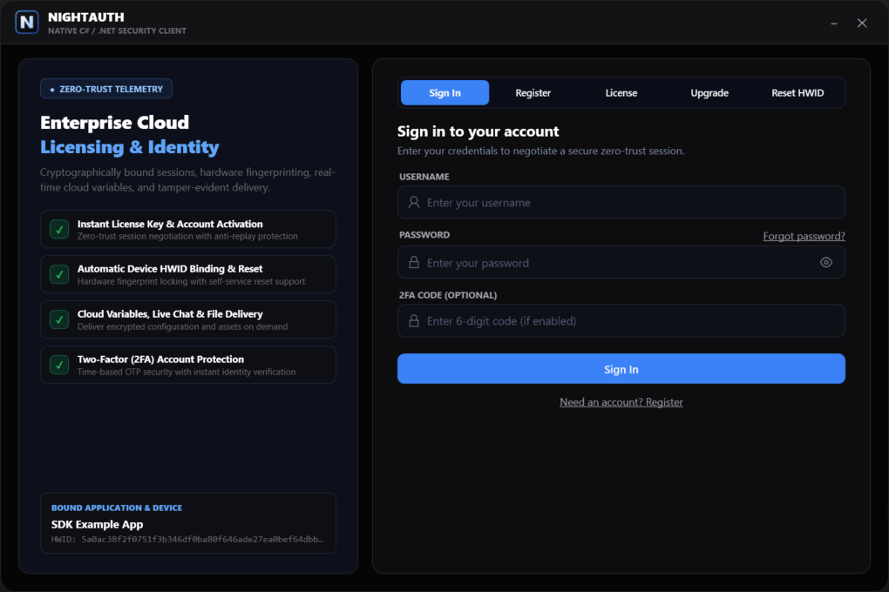
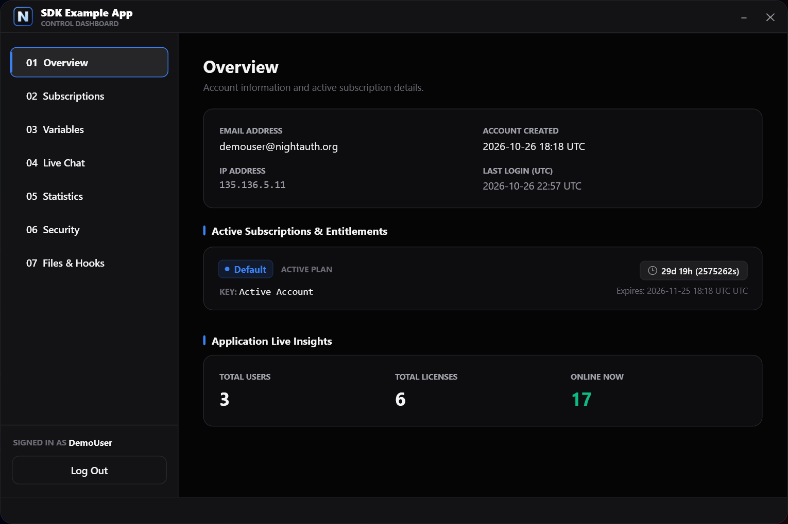
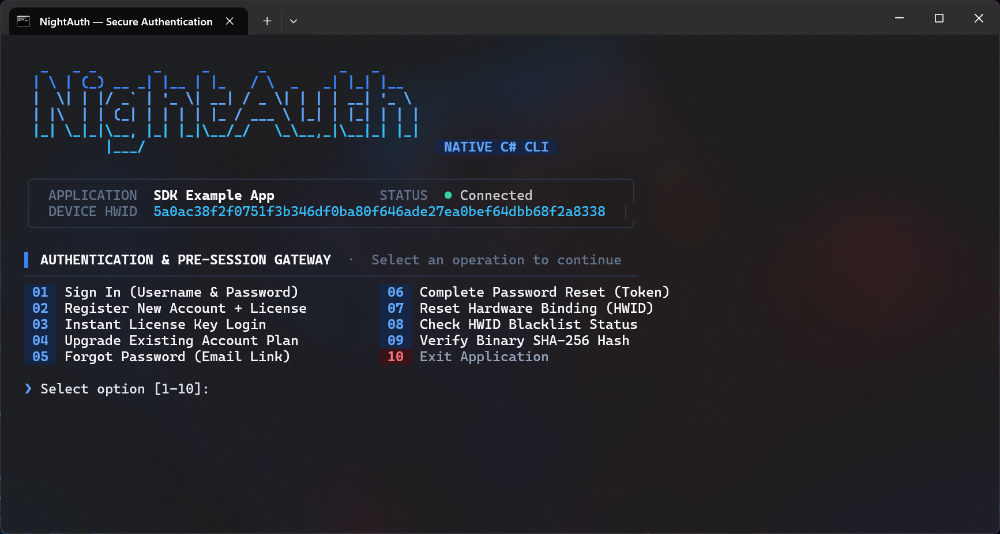
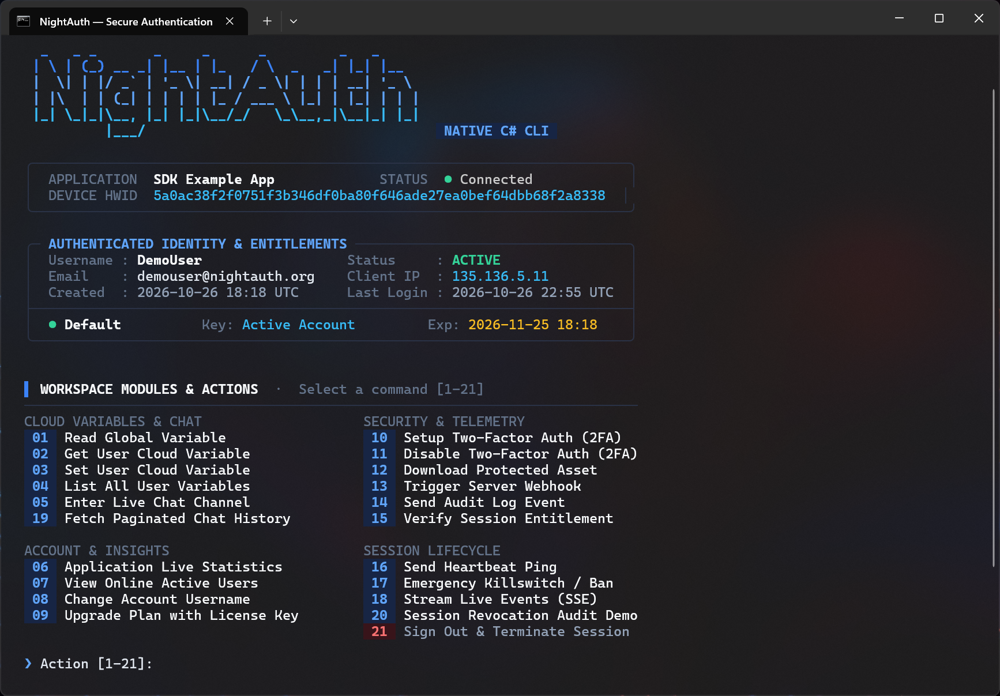

# NightAuth C# .NET SDK — Gib uns einen Stern auf GitHub ⭐

Offizielles **NightAuth** C# / .NET SDK & Referenz-Client-Suite (Moderne Desktop-Benutzeroberfläche in **WPF** und interaktives Terminal in der Konsole). Schützen Sie Ihre .NET-Software in wenigen Minuten vor Piraterie, Reverse Engineering und Manipulation durch Cloud-Lizenzierung, HWID-Sperrung, Live-Chat und Streaming im Arbeitsspeicher.

Offizielles Portal: [https://nightauth.org](https://nightauth.org)

---

**Languages / Idiomas / Langues / Sprachen:**  
[English](../README.md) • [Español](es.md) • [Français](fr.md) • [Deutsch](de.md) • [Italiano](it.md) • [Português](pt.md) • [Русский](ru.md) • [Türkçe](tr.md) • [Polski](pl.md) • [中文](zh.md)

---

> [!NOTE]
> ### 📺 Video-Tutorials & Einrichtungsanleitungen
> Offizielle Video-Tutorials und Schritt-für-Schritt-Anleitungen zur Konfiguration von Anwendungen, Tarifen, Abonnements, Cloud-Variablen, Webhooks und Lizenzen im NightAuth-Dashboard **werden in Kürze veröffentlicht**.

---

## 📸 Screenshots

### Desktop-Anwendung (WPF Enterprise Dark Theme)

| Anmelde- / Authentifizierungsfenster | Dashboard & Abonnementverwaltung |
| :---: | :---: |
|  |  |

### Konsolenanwendung (Interaktives CLI-Terminal)

| Terminal-Anmeldung | Interaktives Konsolen-Dashboard |
| :---: | :---: |
|  |  |

---

## 🛡️ Empfohlene Sicherheitspraktiken

* **Native AOT & Kompilierung:** C#-Bytecode (IL) lässt sich mit Werkzeugen wie dnSpy oder ILSpy dekompilieren. Für Produktionsversionen empfiehlt sich **Native AOT** (`dotnet publish -c Release -r win-x64 /p:PublishAot=true`).
* **Enterprise-Code-Virtualisierung:** Schützen Sie ausführbare Dateien mit professionellen Protectoren wie **VMProtect**, **Themida**, **Eazfuscator.NET** oder **Obfuscar**.
* **Speicherintegrität & Anti-Debugging:** NightAuth stellt den Helper `SecurityProtections` mit Prüfungen gegen System-Proxies, Debugger und blockierte Analyseprozesse bereit (`HTTPDebugger`, `CheatEngine`, `x64dbg`, `Wireshark`, `dnSpy`). Standardmäßig läuft nur die Proxy-Prüfung; rufe `CheckDebugger()` und `CheckBlacklistedProcesses()` für vollständigen Schutz manuell beim Start auf (siehe [SecurityProtections](#22-securityprotections)).
* **Sichere Ausführung im RAM:** Speichern Sie geschützte Dateien (`NightAuthApp.GetFileAsync()`) **nicht auf der Festplatte**. Führen Sie Payloads direkt im Arbeitsspeicher aus (z. B. via `Assembly.Load()`) und überschreiben Sie die Puffer (`CryptographicOperations.ZeroMemory()`) sofort nach Gebrauch.

---

## 📦 Voraussetzungen & Installation

Erfordert **.NET 10.0 SDK** (oder neuer).

```bash
dotnet build NightAuth.sln
```

---

## ⚙️ Konfiguration & Initialisierung

Definieren Sie Ihre Zugangsdaten aus dem NightAuth-Dashboard:

```csharp
public static api NightAuthApp = new api(
    name: "",
    apikey: "",
    version: "",
    token: null
);
```

### Kryptografischen Handshake initialisieren (`InitializeAsync`)

Rufen Sie `InitializeAsync()` vor allen anderen Aufrufen auf. Dies baut den Schlüsselaustausch (X25519) und die verschlüsselte Sitzung auf:

```csharp
var init = await NightAuthApp.InitializeAsync();

if (!init.Success)
{
    Console.WriteLine($"Initialisierung fehlgeschlagen: {init.DisplayMessage}");
    Environment.Exit(1);
}
```

---

## 🚀 SDK-Nutzungsleitfaden

### 1. Sitzungsprüfung & Blacklist-Status

```csharp
// Aktive Sitzung validieren
var check = await NightAuthApp.CheckAsync();
Console.WriteLine($"Sitzungsstatus: {check.DisplayMessage}");

// Prüfen, ob Gerät oder IP auf der Blacklist steht
var blacklist = await NightAuthApp.CheckBlacklistAsync();
if (blacklist.Success && blacklist.Payload["blacklisted"]?.GetValue<bool>() == true)
{
    Console.WriteLine("Zugriff verweigert: Gerät oder IP gesperrt.");
    Environment.Exit(0);
}
```

### 2. Anmeldung mit Benutzername & Passwort (und 2FA)

```csharp
var result = await NightAuthApp.LoginAsync(username, password, totpCode);

if (result.Success)
{
    UserData user = result.ToUserData();
    Console.WriteLine($"Willkommen zurück, {user.Username}!");
}
else
{
    Console.WriteLine($"Anmeldung fehlgeschlagen: {result.DisplayMessage}");
}
```

### 3. Registrierung mit Lizenzschlüssel

```csharp
var result = await NightAuthApp.RegisterAsync(username, password, licenseKey, email);

if (result.Success)
{
    UserData user = result.ToUserData();
    Console.WriteLine($"Erfolgreich registriert: {user.Username}");
}
else
{
    Console.WriteLine($"Registrierung fehlgeschlagen: {result.DisplayMessage}");
}
```

### 4. Nur mit Lizenzschlüssel anmelden (Key Only)

```csharp
var result = await NightAuthApp.LicenseAsync(licenseKey);

if (result.Success)
{
    UserData user = result.ToUserData();
    Console.WriteLine("Lizenz verifiziert. Zugriff gewährt.");
}
else
{
    Console.WriteLine($"Zugriff verweigert: {result.DisplayMessage}");
}
```

### 5. Abonnement erweitern / Schlüssel einlösen (Upgrade)

```csharp
var result = await NightAuthApp.UpgradeAsync(username, newLicenseKey);

if (result.Success)
{
    Console.WriteLine("Abonnement erfolgreich erweitert.");
}
else
{
    Console.WriteLine($"Upgrade fehlgeschlagen: {result.DisplayMessage}");
}
```

### 6. Hardware-ID zurücksetzen (HWID Lock)

```csharp
var result = await NightAuthApp.ResetHwidAsync(username, password, totpCode);

if (result.Success)
{
    Console.WriteLine("HWID-Sperre erfolgreich zurückgesetzt.");
}
else
{
    Console.WriteLine($"HWID-Reset fehlgeschlagen: {result.DisplayMessage}");
}
```

### 7. Passwort vergessen (Forgot Password & Reset)

```csharp
// E-Mail zur Wiederherstellung anfordern
var forgot = await NightAuthApp.ForgotPasswordAsync(email);
if (forgot.Success)
{
    Console.WriteLine("E-Mail zur Wiederherstellung wurde gesendet.");
}

// Passwort mit Token zurücksetzen
var reset = await NightAuthApp.ResetPasswordAsync(token, newPassword);
if (reset.Success)
{
    Console.WriteLine("Passwort erfolgreich zurückgesetzt.");
}
```

### 8. Benutzerprofildaten (`result.ToUserData()`)

```csharp
UserData user = result.ToUserData();

Console.WriteLine($"Benutzer:    {user.Username}");
Console.WriteLine($"Client-IP:   {user.Ip}");
Console.WriteLine($"HWID:        {user.Hwid}");
Console.WriteLine($"Registriert: {user.CreatedAt}");
Console.WriteLine($"Letzter Login: {user.LastLoginAt}");

foreach (var sub in user.Subscriptions)
{
    Console.WriteLine($"Plan: {sub.Subscription} | Ablauf: {sub.Expiry} | Key: {sub.Key}");
}
```

### 9. Cloud-Variablen (Global)

```csharp
var res = await NightAuthApp.GetGlobalVarAsync("server_motd");
string motd = res.Success ? res.Payload["value"]?.GetValue<string>() ?? "" : "";
Console.WriteLine($"Cloud-Variable: {motd}");
```

### 10. Benutzervariablen (User Variables)

```csharp
// Benutzervariable setzen
await NightAuthApp.SetUserVarAsync("discord_tag", "user#0001");

// Benutzervariable abrufen
var res = await NightAuthApp.GetUserVarAsync("discord_tag");
string tag = res.Success ? res.Payload["variable"]?["value"]?.GetValue<string>() ?? "" : "";
Console.WriteLine($"Gespeichertes Discord: {tag}");
```

### 11. Anwendungs-Audit-Logs

```csharp
await NightAuthApp.LogAsync("Verdächtige Speicheränderung erkannt.");
```

### 12. Benutzer sperren & Maschine sperren

```csharp
await NightAuthApp.BanAsync("Sicherheitsmanipulation durch Anti-Cheat festgestellt.");
```

### 13. Server-Webhooks

```csharp
var body = new JsonObject { ["content"] = "Client notification" };
var resp = await NightAuthApp.TriggerWebhookAsync("7kR0UedlVI", body);
Console.WriteLine($"Webhook-Antwort: HTTP {(int)resp.StatusCode}");
```

### 14. Sicheres Herunterladen im Arbeitsspeicher

```csharp
var res = await NightAuthApp.GetFileAsync("385624");

if (res.Success)
{
    byte[] fileBytes = Convert.FromBase64String(res.Payload["data"]?.ToString() ?? "");
    Console.WriteLine($"{fileBytes.Length} Bytes sicher heruntergeladen.");
    // Direkt im Arbeitsspeicher ausführen (z. B. Assembly.Load)
}
```

### 15. Echtzeit-Chatkanäle

```csharp
// Nachricht senden
await NightAuthApp.SendChatMessageAsync("Hallo Community!", channel: "general");

// Nachrichten abrufen
var res = await NightAuthApp.GetChatMessagesAsync("general");
if (res.Success && res.Payload["messages"] is JsonArray messages)
{
    foreach (var msg in messages)
    {
        Console.WriteLine($"[{msg?["author"]}]: {msg?["message"]}");
    }
}
```

### 16. Echtzeit-Ereignishandler (SSE)

```csharp
using var cts = new CancellationTokenSource();

await foreach (var evt in NightAuthApp.ReadEventsAsync(null, cts.Token))
{
    Console.WriteLine($"[EREIGNIS] {evt}");
}
```

### 17. Zwei-Faktor-Authentifizierung (2FA)

```csharp
// TOTP 2FA einrichten
var setup = await NightAuthApp.Setup2FAAsync();
string secret = setup.Payload["secret"]?.GetValue<string>() ?? "";

// Mit 6-stelligem Code bestätigen
var conf = await NightAuthApp.Confirm2FAAsync("123456");

// 2FA deaktivieren
var disable = await NightAuthApp.Disable2FAAsync(password, "123456");
```

### 18. Sitzungslebenszyklus & Abmeldung

```csharp
// Heartbeat zur Aufrechterhaltung der Sitzung
await NightAuthApp.HeartbeatAsync();

// Sitzung beenden und widerrufen
await NightAuthApp.LogoutAsync();
```

### 19. Synchrone API

Jeder Authentifizierungs- und Verwaltungsaufruf besitzt auch ein synchrones Gegenstück in `api` (z. B. `NightAuthApp`): `Init`, `Login`, `Register`, `License`, `Upgrade`, `Heartbeat`, `Check`, `Logout`, `ChangeUsername`, `ResetHwid`, `Ban`, `CheckBlacklist`, `VerifyFileHash`, `ForgotPassword`, `ResetPassword`, `Setup2FA`, `Confirm2FA`, `Disable2FA`, `GetGlobalVar`, `GetUserVar`, `SetUserVar`, `DownloadFile`, `GetChatMessages`, `SendChatMessage`, `Log`, `GetStats`, `GetOnlineUsers` und `TriggerWebhook`. Sie blockieren den aktuellen Thread und melden Ergebnisse über `Response`/`User`/`App` statt ein `NightAuthResult` zurückzugeben:

```csharp
NightAuthApp.Init();

if (NightAuthApp.Login(username, password, totpCode))
{
    Console.WriteLine($"Willkommen zurück, {NightAuthApp.User.Username}!");
}
else
{
    Console.WriteLine($"Login fehlgeschlagen: {NightAuthApp.Response.Message}");
}
```

Nützlicher Zustand der synchronen API: `Response`, `User` (Alias `user_data`), `App` (Alias `app_data`), `LatestVersion`, `ApiUrl`, `PendingDownloadUrl` und `ToOptions()` zum Ableiten eines `NightAuthOptions` aus der aktuellen Instanz.

### 20. Echtzeit-Ereignishandler

`api` stellt High-Level-Events des Echtzeit-Engines bereit sowie explizite Kontrolle über den Hintergrund-Listener:

```csharp
NightAuthApp.OnSessionInvalidated += reason => { Console.WriteLine($"Sitzung ungültig: {reason}"); Environment.Exit(0); };
NightAuthApp.OnAppBanned += reason => Console.WriteLine($"App gesperrt: {reason}");
NightAuthApp.OnAppStatusChanged += status => Console.WriteLine($"App-Status geändert: {status}");
NightAuthApp.OnVersionUpdated += version => Console.WriteLine($"Neue Version verfügbar: {version}");
NightAuthApp.OnChatMessageReceived += (msg, channel) => Console.WriteLine($"[{channel}] {msg.Author}: {msg.Message}");

NightAuthApp.StartRealtimeEventListener(); // SSE-Hintergrund-Listener
// ... später
NightAuthApp.StopRealtimeEventListener();
```

Für volle Kontrolle kannst du den SSE-Stream auch manuell mit `ReadEventsAsync` verarbeiten (siehe Abschnitt 16).

### 21. Eigenständiger `NightAuthClient`

Die moderne Async-Engine ist als unabhängiger Client verfügbar, losgelöst vom Legacy-`api`-Wrapper:

```csharp
var options = new NightAuthOptions(
    BaseUri: new Uri("https://nightauth.org"),
    Name: "my-app",
    ApiKey: "...",
    SigningPublicKey: NightAuthOptions.DefaultSigningPublicKey,
    SealedBoxPublicKey: NightAuthOptions.DefaultSealedBoxPublicKey)
{
    Version = "1.0",
    Token = null,
    RequestTimeout = TimeSpan.FromSeconds(30),
    MaxResponseBytes = 16 * 1024 * 1024,
    AllowInsecureLoopback = true,
    HardwareIdProvider = SecurityProtections.GetHardwareId
};

using var client = new NightAuthClient(options);
var init = await client.InitializeAsync();
var login = await client.LoginAsync(username, password);

if (login.Success)
{
    // NightAuthResult stellt Payload (JsonObject), RetryAfter und Error bereit
    string tag = login.Payload["user"]?["username"]?.GetValue<string>() ?? "";
}
```

Zusätzliche Async-Helfer, sowohl auf `NightAuthClient` als auch auf `api` verfügbar: `ChangeUsernameAsync`, `GetUserVariablesAsync` (listet alle Benutzervariablen), `VerifyFileHashAsync`, `GetStatsAsync`, `GetOnlineUsersAsync` sowie drei `TriggerWebhookAsync`-Überladungen (JSON-Payload, JSON mit eigenem `content`/`parameters` und Multipart-Upload mit Datei: `TriggerWebhookAsync(id, fileBytes, fileName, payload, content, parameters)`).

### 22. `SecurityProtections`

Statische Anti-Manipulations-Helfer. `RunSecurityChecks()` (automatisch von `Init` aufgerufen) führt nur die System-Proxy-Prüfung aus; rufe die übrigen Prüfungen explizit auf:

```csharp
SecurityProtections.CheckSystemProxy();          // beendet bei aktivem System-HTTP-Proxy
SecurityProtections.CheckDebugger();             // beendet bei angehängtem Debugger (lokal oder remote)
SecurityProtections.CheckBlacklistedProcesses(); // sucht Analysewerkzeuge (HTTPDebugger, Cheat Engine, x64dbg, Wireshark, dnSpy, ...)

string hwid = SecurityProtections.GetHardwareId(); // stabile Hardware-ID für den HWID-Lock
```

> [!NOTE]
> Setze die Umgebungsvariable `NIGHTAUTH_IGNORE_SECURITY=1`, um den Prozessscan während der Entwicklung/Tests zu überspringen.

### 23. Signierte Selbst-Updates

Das unsignierte Auto-Update (`ApplyUpdate`) ist veraltet und deaktiviert. Lade und verifiziere stattdessen signierte Releases:

```csharp
// All-in-one-Helfer: lädt das Manifest per HTTPS, verifiziert die Ed25519-Signatur
// gegen deinen gepinnten Release-Key, lehnt veraltete Sequenzen ab, lädt das Artefakt
// herunter und gibt den installierten Dateipfad zurück.
string path = await SignedUpdateInstaller.DownloadAsync(
    manifestUri: new Uri("https://releases.example.com/manifest.json"),
    pinnedReleaseKeyHex: "YOUR_PINNED_ED25519_PUBLIC_KEY_HEX",
    application: "my-app",
    destination: "updates/my-app.exe");

// Oder die Pipeline manuell steuern:
var verified = SignedUpdate.Verify(envelopeJson, pinnedKeyHex, expectedApplication, minimumSequence);
Console.WriteLine($"Verifiziert {verified.Application} v{verified.Version} (Seq. {verified.Sequence})");
await SignedUpdate.DownloadAsync(verified, "updates/my-app.exe");
```

---

## 🖥️ Beispiel-Clients ausführen

Starten Sie die Clients aus dem Verzeichnis `source`:

```bash
# Interaktiver Konsolen-Client
dotnet run --project console/NightAuth.Console.csproj

# Moderner WPF-Desktop-Client (Windows)
dotnet run --project desktop/NightAuth.Desktop.csproj
```

---

## 📄 Lizenz

Dieses Projekt ist unter der **Elastic License 2.0** lizenziert.

* Die Software darf Dritten nicht als gehosteter Dienst zur Verfügung gestellt werden.
* Das Lizenzierungssystem darf weder verändert noch umgangen werden.
* Copyright- und Lizenzhinweise dürfen nicht entfernt werden.

Den vollständigen Text finden Sie in der [LICENSE](../LICENSE)-Datei.
